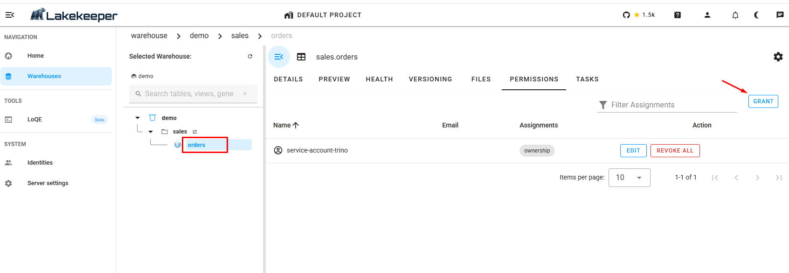
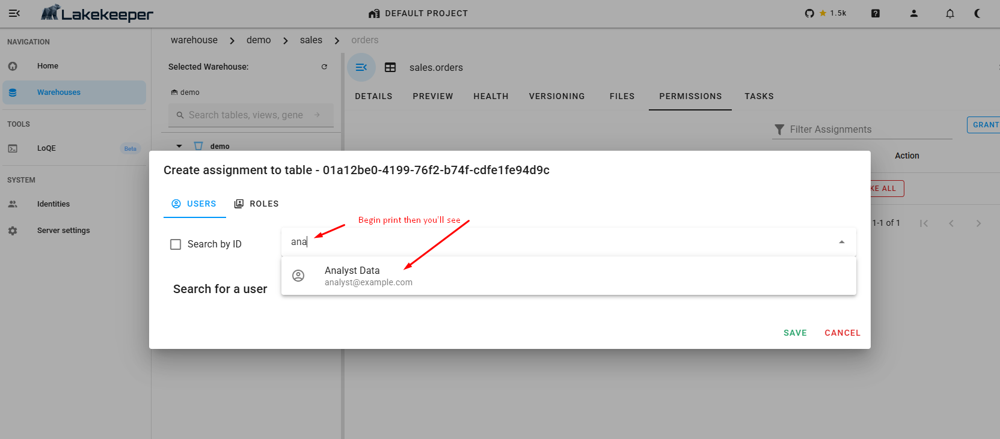
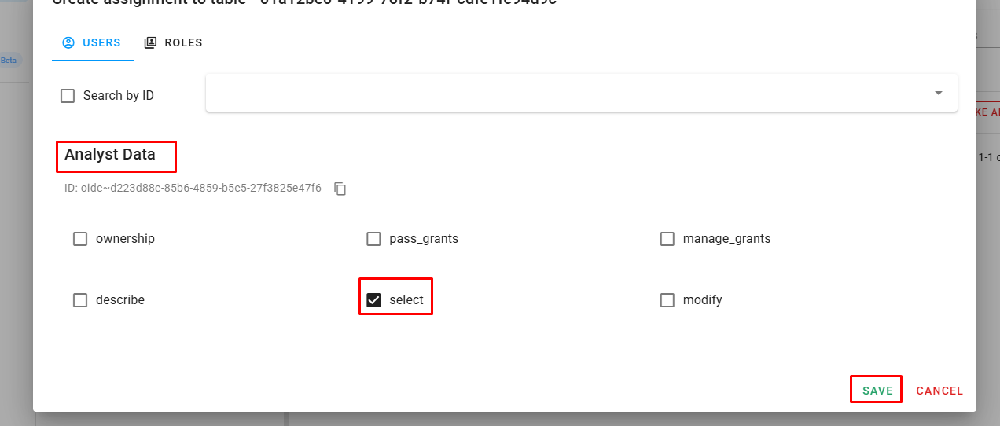

# Выдача прав: engineer открывает таблицу для analyst

Это главная глава стенда. В ней `engineer` выдаёт `analyst` право читать одну таблицу, а дальше вы смотрите, как это право работает в DBeaver и где оно хранится.

Права раздаются в одном месте - в UI Lakekeeper. Trino их не хранит, а перед каждым действием пользователя спрашивает: можно ли. Поэтому выданное в UI право сразу действует в DBeaver, без перезапуска чего-либо.

## Что должно быть готово

Таблица `lakekeeper.sales.orders` должна быть создана, см. [02-first-table.md](02-first-table.md).

Пользователи `engineer` и `analyst` уже заведены в каталоге: это делает скрипт первичной настройки `init/lk-init.sh` при запуске стенда, через API Lakekeeper, по идентификатору пользователя из Keycloak. Без этого Lakekeeper узнаёт о пользователе только при его первом входе, и до первого входа человека нельзя найти в окне выдачи прав. В компании такую заливку пользователей делает скрипт синхронизации с AD или LDAP.

Удобная расстановка: DBeaver подключён под `analyst` (как переключиться - в [01-dbeaver.md](01-dbeaver.md#как-сменить-пользователя)), а UI Lakekeeper открыт под `engineer` в другом браузере или в приватном окне. Так не придётся всё время перелогиниваться.

## Шаг 1. До выдачи прав

В DBeaver под `analyst`:

```sql
SELECT count(*) FROM lakekeeper.sales.orders;
```

Ответ:

```
Access Denied: Cannot access catalog lakekeeper
```

У analyst нет прав ни на один объект каталога, поэтому Trino не пускает его даже в сам каталог. В дереве DBeaver каталог `lakekeeper` пустой.

## Шаг 2. Выдать право в UI Lakekeeper

1. Откройте http://localhost:8181/ui и войдите как `engineer` / `engineer`.
2. Слева выберите Warehouses, затем в дереве `demo` → `sales` → `orders`.
3. Перейдите на вкладку **PERMISSIONS** и нажмите **GRANT** справа.



В списке уже есть одна запись: `service-account-trino` с правом `ownership`. Таблицу создал Trino, а в каталог Trino ходит под технической учёткой `trino`, поэтому владельцем стала она, а не engineer. Подробнее об этом - в разделе "Кто владелец таблицы" ниже.

4. В окне Create assignment на вкладке **USERS** начните вводить имя в поле поиска, например `ana`. Появится `Analyst Data` - выберите его.



Поиск работает по мере ввода. Если пользователь не находится, проверьте, что он хоть раз входил, и обновите страницу.

5. Отметьте **select** и нажмите **SAVE**.



## Шаг 3. Проверить в DBeaver

В DBeaver под `analyst` обновите дерево (F5) и выполните:

```sql
SELECT count(*) FROM lakekeeper.sales.orders;
```

Теперь запрос проходит. В дереве каталога `lakekeeper` появилась схема `sales` и в ней одна таблица `orders`. Если вы создавали в `sales` другие таблицы, analyst их не видит: право выдано только на эту.

Попробуйте то, на что права нет:

```sql
INSERT INTO lakekeeper.sales.orders SELECT * FROM tpch.tiny.orders LIMIT 1;
-- Access Denied: Cannot insert into table lakekeeper.sales.orders

DROP TABLE lakekeeper.sales.orders;
-- Access Denied: Cannot drop table lakekeeper.sales.orders

ALTER TABLE lakekeeper.sales.orders EXECUTE optimize;
-- Access Denied: Cannot execute table procedure OPTIMIZE on lakekeeper.sales.orders
```

Право `select` даёт чтение и ничего больше.

## Какие бывают права

В окне выдачи прав на таблицу шесть флажков:

| Право | Что даёт |
|---|---|
| `describe` | видеть таблицу и её метаданные (колонки, свойства), без чтения данных |
| `select` | читать данные |
| `modify` | менять данные: вставка, удаление, обновление, а также процедуры обслуживания таблицы |
| `ownership` | владение: все права на таблицу и доступ к раздаче прав на неё |
| `pass_grants` | передавать другим свои права. Само право передачи не передаётся |
| `manage_grants` | управлять всеми правами на таблицу |

Права выдаются не только на таблицу. На вкладке PERMISSIONS схемы (`sales`) или warehouse (`demo`) выдача устроена так же, и права наследуются вниз: `select` на схему `sales` даёт чтение всех её таблиц, в том числе созданных потом. Для групп пользователей в окне выдачи есть вкладка ROLES: право выдаётся роли, а роль - пользователям.

Попробуйте сами: снимите право с таблицы (кнопка EDIT или REVOKE ALL в строке analyst) и выдайте `select` на схему `sales`. Затем под engineer создайте в `sales` вторую таблицу и проверьте, видит ли её analyst.

## Что происходит на каждый запрос

Когда analyst выполняет `SELECT`, Trino не решает сам, можно ли:

```
DBeaver (analyst) --> Trino
Trino --"можно ли analyst читать sales.orders?"--> OPA
OPA --batch-check от имени analyst--> Lakekeeper --> OpenFGA
                                                      |
              разрешено / запрещено <-----------------+
```

- **OpenFGA** хранит само право - одну запись вида "analyst - select - таблица orders".
- **Lakekeeper** знает устройство каталога и спрашивает OpenFGA с учётом наследования: право на схему действует на её таблицы.
- **OPA** переводит вопрос Trino ("можно ли SELECT") на язык Lakekeeper ("есть ли `read_data`").
- **Trino** выполняет запрос или отвечает `Access Denied`.

Так права хранятся в одном месте и одинаково действуют для всех, кто ходит в каталог: для Trino, для UI Lakekeeper, для Spark или загрузчика данных.

## Где видно отказы

Каждая проверка прав попадает в журнал аудита Lakekeeper. Это строки JSON в логе контейнера с `"event_source":"audit"`.

Проверки, которые Trino делает за пользователя, приходят от учётки `trino`, а сам пользователь указан внутри, в поле `for-principal`. Отказы analyst на запись в таблицу:

```bash
docker logs lab-lakekeeper 2>&1 | grep '"for-principal":{"user":"oidc~d223d88c' | grep '"write_data"' | grep '"allowed":false'
```

`d223d88c-...` - идентификатор analyst из Keycloak, его же показывает UI Lakekeeper в окне выдачи прав (строка `ID: oidc~...`) и `SELECT current_user` в Trino.

В каждой строке видно, кто спрашивал (`actor`), за кого (`for-principal`), какое действие (`action_name`), над чем (`entity`) и ответ (`allowed`). Из таких событий в компании собирают журнал для системы мониторинга безопасности (SIEM).

Если пользователь сам обращается к каталогу (например, через UI Lakekeeper) и получает отказ, событие помечено `"decision":"denied"`.

## Кто владелец таблицы

Таблицы, созданные через Trino, принадлежат технической учётке `trino`, а не пользователю, который выполнил `CREATE TABLE`. Каталог видит только того, кто к нему обратился, а Trino обращается под своей учёткой.

Отсюда два следствия:

- аналитик, создавший таблицу в DBeaver, не сможет сам раздать на неё права в UI Lakekeeper. Это сделает администратор (в стенде - engineer);
- таблицы, созданные напрямую через каталог (UI Lakekeeper, Spark, загрузчик под учёткой `loader`), принадлежат тому, кто их создал, и владелец может раздавать на них права сам.

## Новый пользователь

Учётки людей живут в Keycloak, права - в Lakekeeper. Lakekeeper не хранит пароли и не создаёт пользователей с логином: он знает только идентификатор пользователя из токена Keycloak, его имя и почту. Поэтому новый пользователь всегда начинается в Keycloak.

### Шаг 1. Создать учётку в Keycloak

1. Откройте http://localhost:30080/admin и войдите как `admin` / `admin`.
2. Слева вверху выберите realm `iceberg`.
3. Меню Users, кнопка Add user. Заполните Username (например, `auditor`), Email, First name, Last name и нажмите Create.
4. На странице пользователя откройте вкладку Credentials, нажмите Set password, задайте пароль и **выключите Temporary**. Иначе при первом входе Keycloak потребует сменить пароль.

### Шаг 2. Первый вход

Новый пользователь входит в UI Lakekeeper (http://localhost:8181/ui) или подключается к Trino через DBeaver. В этот момент Lakekeeper видит незнакомый токен и заводит пользователя у себя.

До первого входа пользователь в окне выдачи прав не находится. Обойти это можно, заведя его в Lakekeeper заранее через API, как делает `init/lk-init.sh` для engineer и analyst: запрос `POST /management/v1/user` с идентификатором `oidc~<ID>`, где `<ID>` - поле ID на странице пользователя в Keycloak.

### Шаг 3. Выдать права

Под `engineer` в UI Lakekeeper выдайте новому пользователю права так же, как analyst в шаге 2 этой главы. В поиске он теперь находится.

### Как это устроено в компании

Учётки руками в Keycloak обычно никто не заводит. Keycloak подключён к Active Directory или LDAP (раздел User federation в админке Keycloak), и сотрудник, заведённый в AD, сразу входит со своим доменным паролем. Остаётся донести пользователей и их группы до Lakekeeper и выдать права. В открытой версии Lakekeeper с OpenFGA группы из AD сами не подтягиваются, это делает свой скрипт синхронизации через API, подробнее в [06-limitations.md](06-limitations.md).

## Что запомнить

- Права раздаются в UI Lakekeeper и сразу действуют в Trino.
- Право выдаётся на таблицу, схему или warehouse и наследуется вниз.
- Хранит права OpenFGA, проверяет Lakekeeper, Trino спрашивает через OPA.
- Отказы видны в журнале аудита Lakekeeper.
- Через Trino владельцем таблиц становится учётка `trino`.
- Учётки людей создаются в Keycloak, права выдаются в Lakekeeper.

Дальше: [04-snapshots.md](04-snapshots.md) - снимки, путешествие во времени и изменение схемы.
